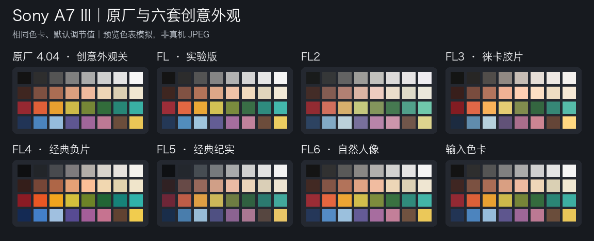

# Sony A7 III 4.04 菜单实验

针对 Sony α7 III（**ILCE-7M3**）4.04 的中文菜单修改、QEMU 验证和本地 USB 更新工具。示例将「影像质量/影像尺寸」改为「我的相机/固件实验」。这个改动已在一台实机上完成烧录、断电重启、菜单目视确认和 USB 回读。

**当前发布：[v0.01 完整整合版 · SD 导入与独立风格](https://github.com/robinshie/Sony_A7M3/releases/tag/v0.01)。** 保留 FL～FL6、五点曲线及拍后颗粒／光晕／暗角的 JPEG L/M/S 支持；新增同级 SD 导入入口、独立自定义外观、确认删除，以及下拉和选定值的动态名称。导入、删除和重启名称已获开发机验收，原六套参数保持不变。

**下载内容：** 同一个 ZIP 包含整合模块、中英文菜单增量补丁、离线生成器、完整源码、示例 `.a7look`、说明和校验文件。依赖匹配的项目加载器、菜单资源及部署前像，不是原厂固件一键直装包。详见 [本次使用与安装范围](docs/custom-look-release.md)、[原厂功能比较](docs/edition-comparison.md)。

**验证边界：** 三种拍后效果已验证全画幅 3:2 JPEG L／M／S。RAW、实时取景、APS-C 和 16:9 不在本次验证范围。锐度、锐度范围、清晰度仍只确认调节和保存；五点曲线各控制的视觉效果仍待独立比较。详见 [L／M／S 实拍记录](docs/jpeg-size-adaptation.md)。

同一输入色卡、默认调节值，使用整合版预览色表模拟；非真机 JPEG。详细说明见[功能与配色对照](docs/edition-comparison.md)。

| 要做什么 | 从这里开始 |
| --- | --- |
| 在 QEMU 看菜单、调显示和试改标题 | [QEMU 菜单实验](docs/ui.md) |
| 核对整合版、查看更新流程、打开 QEMU 与了解 Sony 官方更新步骤 | [操作步骤与流程图](docs/release-workflow.md) |
| 比较原厂 4.04、当前 v0.01 和 FL1–FL6 整合版 | [功能与配色对照](docs/edition-comparison.md) |
| 查看「复古衣橱」原厂菜单与配方补丁（v3 名称与定位修复已烧录、重启验收通过） | [创意风格实验](docs/creative-style.md) |
| 继续开发完整胶片算法、研究机内图像处理入口 | [算法开发 TODO](TODO.md) |
| 生成 FL 近似实验版 3D LUT、预览照片、快速测试 | [FL 本地算法](docs/fl-look.md) |
| 导出、编辑和预览六风格配方，生成导入候选 | [六风格配方](docs/look-recipes.md) |
| 在真机加载/恢复由 Mac 开关的 FL 近似试用表 | [真机 FL 试用](docs/native-fl.md) |
| 原生「创意外观」菜单、五项 LUT 调节和保存（机身操作与回读已验证） | [机内菜单模块](docs/native-creative-look.md) |
| 复现扩展 Gamma 控制接口的原厂 ARM 测试 | [机内色彩接口研究](docs/color-interface.md) |
| 构建和验证复古衣橱的 RW 图标修复 | [图标修复](docs/style-icons.md) |
| 在本地构建镜像、备份、烧录、回读或恢复 | [真机操作手册](docs/updater.md) |
| 查看测试覆盖范围和官方更新器限制 | [验证记录](docs/validation.md) |
| 研究原厂内核启动和启动图 | [原厂启动实验](boot-lab/README.md) |

本地工具从该相机的原始备份构建 300 MiB 的完整 `/usr` 分区镜像。示例镜像有 **44 字节**不同，真机只写入包含它们的一个 **512 字节扇区**。这不是整机闪存镜像，也不生成 Sony 官方签名的 DAT。镜像构建和 QEMU 菜单实验都可以在不连接相机的情况下完成。

仓库只包含源码、文档和补丁。请从 [Sony 官网](https://www.sony.com/electronics/support/e-mount-body-ilce-7-series/ilce-7m3/downloads) 获取原始 4.04，所需的固件、字体和图标均从本地副本读取。请把相机设置备份、分区镜像、虚拟机、编译产物和日志放在忽略目录 `.lab/`，不要提交到 GitHub。

项目源码采用 [MIT 许可证](LICENSE)。对 QEMU 的 [机器补丁](boot-lab/a7m3-qemu.patch) 和 [Cocoa 补丁](boot-lab/cocoa-retina-fit.patch) 分别遵循其上游文件的 [GPL-2.0-or-later](licenses/GPL-2.0.txt) 和 [MIT 条款](licenses/QEMU-Cocoa.txt)。
