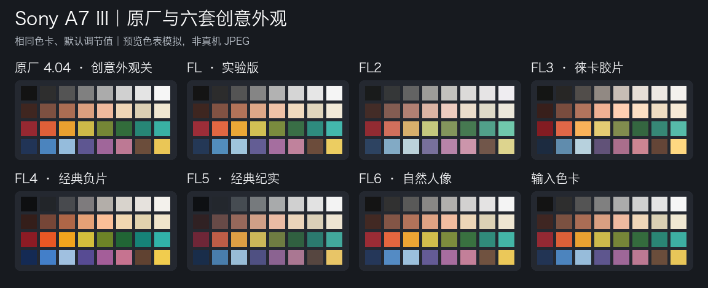

# A7 III 4.04：原厂与六风格整合版对照

当前公开入口是 [v0.01 六风格整合版](https://github.com/robinshie/Sony_A7M3/releases/tag/v0.01)。六风格整合版在 r16 上加入 FL4、FL5、FL6，保留原有三套配色、菜单和拍后功能。内部构建号用于定位差异；已完成用户真机验收，使用同一个 v0.01 入口，用户只需看这一版的功能清单和适用基线。

| 功能 | Sony 原厂 4.04 | 上一三风格版（r16） | 六风格整合版 |
| --- | --- | --- | --- |
| 原厂「创意风格」 | 原厂菜单和选项 | 保留，并加入「复古衣橱」 | 沿用 r16 |
| 单独的「创意外观」 | 无此项目菜单 | 关、FL、FL2、FL3 | 原有选项 + FL4、FL5、FL6 |
| 调整、确认、取消与重启恢复 | 各功能使用原厂菜单 | 三套 FL 独立保存 | 六套独立保存，可读入旧三套参数 |
| 对比度、高光、阴影、褪色、饱和度 | 原厂功能另行设置 | 在创意外观取景和拍照路径使用 | 沿用，新增三套 LUT |
| 五点曲线 | 无项目五点曲线 | 黑位、暗部、中间调、亮部、白位 | 六套都可独立调整；新风格拍照正常；曲线效果待独立比较 |
| 颗粒、正负光晕、正负暗角 | 无项目三项拍后控制 | 全画幅 3:2 JPEG L 已验收；不改变 RAW 或实时取景 | 沿用 r16 拍后模块；新增三风格拍照回放已确认；未重测每项效果 |
| 锐度、锐度范围、清晰度 | 原厂功能另行设置 | 此菜单中可调并保存 | 沿用；未验证其改变图像 |
| 更新范围 | Sony 官方完整更新包 | 已配置 r15 光晕版的项目升级 | r16 基础上的已验收升级；尚无原厂直装包 |

## 新配色

使用同一合成色卡、各风格默认调节值和整合版真实预览 LUT，在假定的 YCbCr 显示模型中生成。此图为模拟对比，非真机 JPEG；不包含镜头、传感器、实机 ISP 或拍后颗粒、光晕、暗角。

| 风格 | 特点 | 适合 |
| --- | --- | --- |
| FL4 经典负片 | 暗部偏冷，上半部偏暖，中间调颜色更浓 | 街拍、服饰和日光下的复古场景 |
| FL5 经典纪实 | 整体降饱和，蓝绿阴影更明显，亮部较克制 | 纪实、街景、阴天 |
| FL6 自然人像 | 对比柔和，皮肤和亮部微暖，压住高光 | 人像、柔光和浅色衣物 |

三套都是项目配色，分别参考 [Fujifilm Classic Neg.](https://www.fujifilm-x.com/global/products/film-simulation/classic-neg/)、[Classic Chrome](https://www.fujifilm-x.com/global/products/film-simulation/classic-chrome/) 与 [Hasselblad Natural Colour Solution](https://www.hasselblad.com/learn/hasselblad-natural-colour-solution/) 的观感。出厂配色、原有 FL1–FL3 和新风格可以用同一张模拟色卡比较。生成方法见下文，实际效果以固定曝光和白平衡的机内 JPEG 为准。

## 构建与验收

2026-11-15：六风格候选已写入开发机，模块（124,980 字节）及中英文资源均完整回读一致。原有两个配置槽和两个工作记录逐字节保留。用户已确认六个入口、新三风格拍照回放、参数独立保存及重启保留正常；回读确认驻留无错误。

此次模块 SHA-256：`5fb33e6955b81e02144463e6fb7e09aaa042b3e4df536fd9523854a91d2fa6d5`。升级使用 `deploy_six_looks.py`，逐文件校验 r16 前像、保留旧文件和独立日志，验证当前设置能够迁移后才写入。已执行的包不可重放。这里只沿用一个公开版本名 v0.01，安装事务编号用于追踪证据。

使用现有 r16 构建输入，追加 `--six-looks`。先运行 `research/native_fl_classic_strings.py` 生成新增名称，再用 `research/native_resource_fixture.py --classic-looks --before .lab/native-fl-vignette-strings --after .lab/native-fl-classic-strings --usr "$SONY_USR"` 验证语言资源。完整 r16 前置输入和依赖见[暗角记录](vignette.md)。输出 `.lab/native-module-six-looks/` 与 r16 独立。

离线验收检查 Off 的三张原始色表逐字节恢复，六套参数独立，以及旧 128 字节设置迁移。新格式同样使用 128 字节；首次确认保存后旧版不支持新格式。回退需要保留升级前的设置及工作记录。QEMU 测试使用原厂菜单组件和模拟拍摄通路。

构建报告保留 `ready_for_staging=false`，专用六风格安装路径另行核对该候选的完整测试证据和已验收 r16 前像，不改写为真机已验收。真机验收时至少要核对 FL1–FL3 旧设置依然存在；同一场景拍「关、FL4、FL5、FL6」四张固定曝光和固定白平衡的全画幅 3:2 JPEG L；检查新风格确实改变取景和 JPEG；三套新风格各保存不同值，再断电重启核对。通过后才用一个包含当前功能的包覆盖 v0.01。原厂 4.04 直接初装是另一个交付目标，当前公开包需要[匹配的已有加载器和项目安装基线](release-workflow.md)。

色卡对比：安装 Pillow 后运行 `python3 research/classic_look_preview.py --build .lab/native-module-six-looks --output .lab/classic-look-comparison.png`。用相同合成输入和构建中的真实预览 LUT，以假定的 YCbCr 显示模型比较配色；不包含镜头、传感器、实机 ISP 或拍后纹理。
