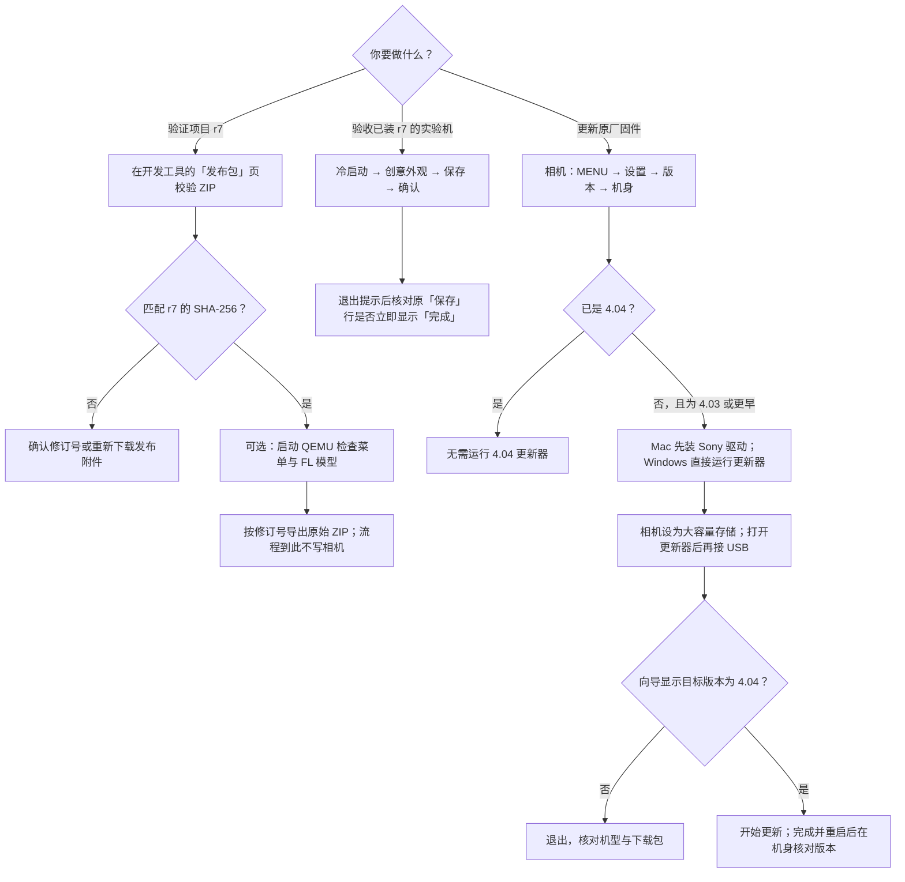

# A7M3：项目验证与官方更新

项目的 **v0.01 / r7** 是创意外观模块更新，唯一的安装组件是 `a7fl.so`。macOS 开发工具用于离线校验、仿真和导出；Sony System Software Updater 用于更新原厂系统。原厂 A7M3 4.04 没有可用的 r7 初装包。



## 需要安装什么

| 目的 | 软件和输入 | 要接相机吗 |
| --- | --- | --- |
| 只核对 r7 ZIP | Release 附件，外加 macOS 的 `shasum`，或手头已有的 A7M3 开发工具 | 不需要 |
| 运行已有 QEMU 模型 | `qemu-system-arm` 和已构建的菜单模型 `a7m3-ui.elf` | 不需要 |
| 从源码构建 QEMU 模型 | QEMU、Python 3、Pillow、`arm-none-eabi-gcc`、项目 v0.01 源码、本地解包的 Sony 4.04 界面资源 | 不需要 |
| 用 Mac 更新原厂 4.04 | [Sony 官方 Mac 更新页](https://www.sony.com/electronics/support/software/00257843)上的相机驱动和 `Update_ILCE7M3V404.dmg`；另备 USB 数据线和充满的 NP-FZ100 | 更新器打开后按提示接入 |
| 用 Windows 更新原厂 4.04 | [Sony 官方 Windows 更新页](https://www.sony.com/electronics/support/software/00257839)上的 `Update_ILCE7M3V404.exe`；另备 USB 数据线和充满的 NP-FZ100 | 更新器打开后按提示接入 |

官方 USB 更新不需要 QEMU、UTM、Python 或项目 GUI。QEMU 仿真也不需要 Sony 相机驱动。

## 用开发工具核对 r7

1. 下载 [v0.01 Release](https://github.com/robinshie/Sony_A7M3/releases/tag/v0.01) 的 `Sony_A7M3-v0.01.zip` 附件。不要选 GitHub 自动生成的源码 ZIP。r5、r6、r7 曾使用同一个文件名，不能凭名称区分。
2. 如果手头已有 `A7M3-Package-Library-macOS.zip`，解压应用，打开「发布包 → 添加文件」，选择刚下载的 ZIP。正确的文件会显示「匹配 r7 发布 ZIP」。开发工具和相机模块是两个不同的文件；Release 的模块附件不包含这个应用。
3. 没有 GUI 时，在下载目录运行 `shasum -a 256 Sony_A7M3-v0.01.zip`。r7 应为 `eff0c93cb08a3c739fe0bd93c3b42b971f82bb241b7b208918de11159c41edfb`。不一致就核对修订和下载来源。
4. 要保留一个容易分辨的副本，在 GUI 的「发布包」页点 r7 的「导出 ZIP」。它会将原包另存为 `Sony_A7M3-v0.01-r7.zip`，内容不变。已有的模块和加载器回读文件也可以在同一页比对。

## 安装 QEMU 并运行 FL 界面模型

如果已经有本项目生成的 `ui/build/fl-demo/a7m3-ui.elf`，只需安装 [Homebrew 的 QEMU](https://formulae.brew.sh/formula/qemu)，即 `brew install qemu`。在开发工具点「QEMU 仿真 → FL 创意外观模型」，如果没有自动找到 ELF，点「选择本地 ELF」指定该文件，再点「启动 QEMU」。

没有 ELF 时，从 [v0.01 的源码](https://github.com/robinshie/Sony_A7M3/tree/v0.01)进入仓库根目录。先准备可用的 Python 3 和本地已解包的 Sony 4.04 界面资源；发布 ZIP 不提供这些资源。将下面的固件目录示例替换成实际绝对路径：

```sh
brew install qemu arm-none-eabi-gcc
mkdir -p .lab
python3 -m venv .lab/qemu-venv
.lab/qemu-venv/bin/python -m pip install Pillow
export A7M3_FIRMWARE_ROOT="/你的实际路径/firmware.tar_unpacked"
.lab/qemu-venv/bin/python ui/build.py --fl
.lab/qemu-venv/bin/python ui/run-ui.py --guest ui/build/fl-demo/a7m3-ui.elf
```

最后一行会打开独立的 640×480 窗口。也可以用 GUI 打开同一个 ELF。用方向键和 Enter 在「创意风格」旁打开「创意外观」，选择「FL（实验版）」；也可以从模拟取景界面按 F 进入 Fn。更多按键见 [v0.01 的 QEMU 菜单实验](https://github.com/robinshie/Sony_A7M3/blob/v0.01/docs/ui.md)，编译器见 [Homebrew ARM GCC](https://formulae.brew.sh/formula/arm-none-eabi-gcc)。仿真运行的是独立模型，不能证明发布 ZIP 能在真机运行。

## r7 真机适用条件与验收

实验中验证过的是匹配 r6、已有项目加载器和菜单资源、且色彩表符合条件的机身。相机显示 4.04 或离线校验通过，都不能单独证明具备这些条件。当前没有面向原厂机的 r7 安装器；Sony 更新器和本项目 GUI 都不能安装这个补丁。UTM 是之前实验的 USB 转接环境，本工具无需 UTM。

当时的实验范围是替换一台已配置机身上的单个 `a7fl.so` 模块，再完整回读和冷启动验收。它没有写入完整固件，也没有验证从原厂机初装。下列步骤适用于已经安装完成的机身。

已经装好 r7 的实验机无需重刷，可以用下面的步骤验收：

1. 关机再开机，使用照片模式，进入「MENU → 拍摄设置 1 → 第 14 页 → 创意外观」。
2. 记下一个参数的原值，改动它，在第二页选「保存」，再选「确认」。成功时应出现「完成」提示。
3. 关闭提示并返回菜单。原「保存」行应立即显示「完成」，不用上下移动或退出后重新进入。验收后可把参数调回原值并保存。

这是 r7 修复的菜单行为。若入口不存在或文字仍要移动光标才刷新，验收未通过；不能据此判断具体固件修订。手头已有 `a7fl.so` 回读文件时，可以在 GUI 中另行核对是否匹配 r7。

## 用 Sony 工具更新原厂系统

1. **确认机身和版本。** 查看机身型号标签，然后在「MENU → 设置 → 版本 → 机身」看当前版本。适用的 A7M3 原厂 4.03 或更早版本可按下列步骤更新；已是 4.04 就不需要重复更新。不要把别的机型的更新包拿来试。
2. **下载并启动工具，先别接相机。** 在 Sony 对应页面确认操作系统受支持。Mac 先打开相机驱动 DMG，运行 `SonyCameraDriver.pkg`；按官方说明处理系统扩展或重启提示。再打开 `Update_ILCE7M3V404.dmg`，运行 `SystemSoftwareUpdater`。Windows 则直接运行 `Update_ILCE7M3V404.exe`。遇到驱动许可提示，以 [Sony Mac 安装说明](https://www.sony.com/electronics/support/software/00257843)为准。
3. **准备相机。** 装入充满的 NP-FZ100，取出存储卡，拆下竖拍手柄（如有）。在相机「MENU → 设置 → USB 连接」选「大容量存储」。电脑保持供电，避免在更新期间进入睡眠。
4. **按提示接 USB。** 相机开机，使用数据线直接连电脑。看到机身的 USB 模式提示后，在更新器点「下一步」，检查当前版本与更新后的版本；只在机身和目标版本都核对无误时继续。如果还没开始写入而工具没有识别设备，先核对 USB 模式、数据线和电脑端 USB 口，再按 Sony 对应页面排查。
5. **等待完成。** 开始更新后，相机会自动重启并显示进度。不要拔 USB、取电池或关机。等相机再次启动、LCD 恢复、更新器可以点「完成」，点完再拔 USB。若更新未完成或报错，按 [Sony Mac](https://www.sony.com/electronics/support/software/00257843)或 [Sony Windows](https://www.sony.com/electronics/support/software/00257839)页面的故障处理说明操作。
6. **回查版本。** 在机身「MENU → 设置 → 版本 → 机身」确认是 4.04。这个结果表示原厂系统更新完成，不表示安装了项目 r7。
