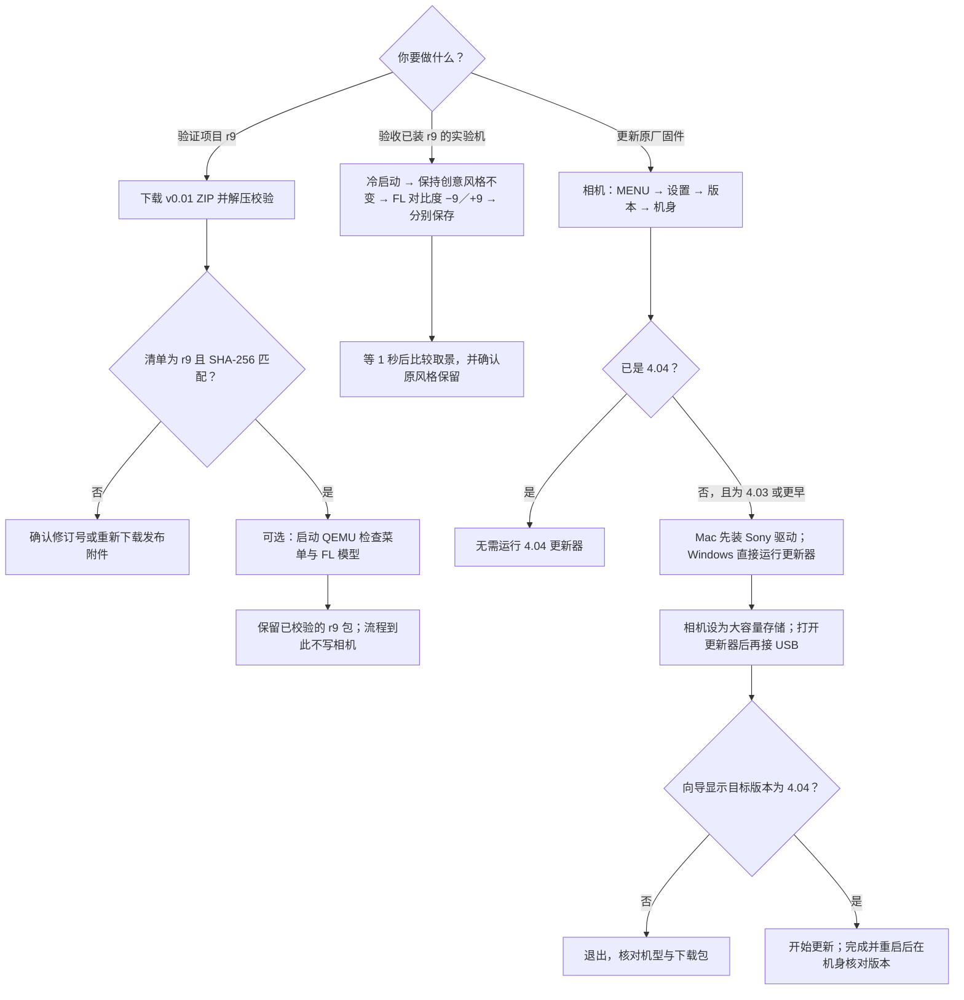
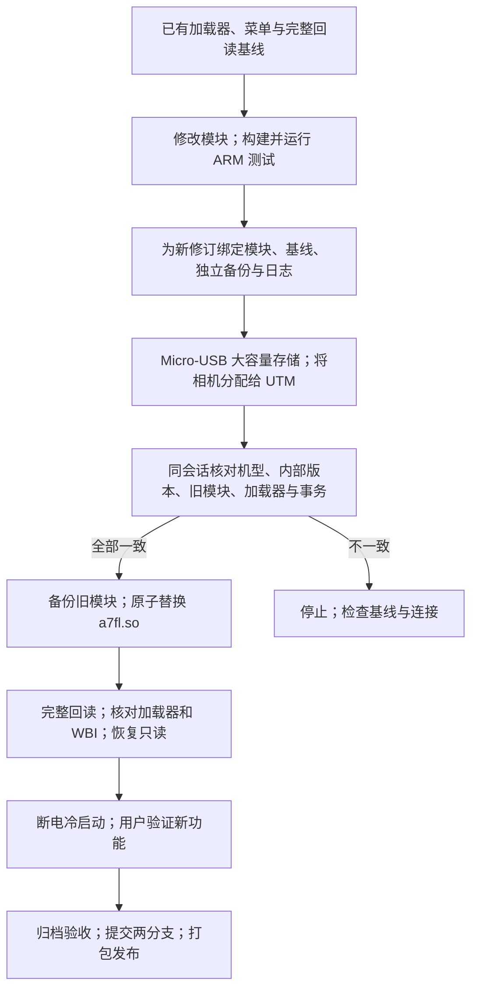

# A7M3：项目验证与官方更新

项目的 **v0.01 / r9** 是创意外观模块更新，唯一的安装组件是 `a7fl.so`。macOS 开发工具用于离线校验、仿真和导出；Sony System Software Updater 用于更新原厂系统。原厂 A7M3 4.04 没有可用的 r9 初装包。r9 已由用户冷启动验证：调整创意外观后取景更新，无需手动切换创意风格，原风格保留。



## 需要安装什么

| 目的 | 软件和输入 | 要接相机吗 |
| --- | --- | --- |
| 只核对 r9 ZIP | Release 附件，外加 macOS 的 `unzip` 和 `shasum` | 不需要 |
| 运行已有 QEMU 模型 | `qemu-system-arm` 和已构建的菜单模型 `a7m3-ui.elf` | 不需要 |
| 从源码构建 QEMU 模型 | QEMU、Python 3、Pillow、`arm-none-eabi-gcc`、项目 v0.01 源码、本地解包的 Sony 4.04 界面资源 | 不需要 |
| 用 Mac 更新原厂 4.04 | [Sony 官方 Mac 更新页](https://www.sony.com/electronics/support/software/00257843)上的相机驱动和 `Update_ILCE7M3V404.dmg`；另备 USB 数据线和充满的 NP-FZ100 | 更新器打开后按提示接入 |
| 用 Windows 更新原厂 4.04 | [Sony 官方 Windows 更新页](https://www.sony.com/electronics/support/software/00257839)上的 `Update_ILCE7M3V404.exe`；另备 USB 数据线和充满的 NP-FZ100 | 更新器打开后按提示接入 |

官方 USB 更新不需要 QEMU、UTM、Python 或项目 GUI。QEMU 仿真也不需要 Sony 相机驱动。

## 下载并核对 v0.01 / r9

1. 下载 [v0.01 Release](https://github.com/robinshie/Sony_A7M3/releases/tag/v0.01) 的 `Sony_A7M3-v0.01.zip` 附件。GitHub 自动生成的源码 ZIP 不含模块。旧版也使用相同文件名，需看清单和散列。
2. 先用 `shasum -a 256 Sony_A7M3-v0.01.zip` 与 Release 正文的 ZIP 散列比较。解压后进入 `Sony_A7M3-v0.01`，执行 `shasum -a 256 -c SHA256SUMS`，全部应显示 `OK`。
3. 打开 `release-manifest.json`，确认 `release` 为 `v0.01`、`module_revision` 为 `r9`，模块为 67,740 字节，SHA-256 为 `c2a8c2b9fc03b90c7695a775d6d14cd1813ebe38ca2f6924fef36dc9299fa5cc`。
4. 这个 ZIP 包含 `a7fl.so`、中文说明、版本清单和校验文件；不含 UTM、原厂固件或相机备份。已有的旧版 Package Library GUI 只内置 r5/r6/r7 指纹，不能用它对 r9 的识别结果代替上述校验；其 QEMU 启动功能仍可用于独立界面模型。

## 安装 QEMU 并运行 FL 界面模型

如果已经有本项目生成的 `ui/build/fl-demo/a7m3-ui.elf`，只需安装 [Homebrew 的 QEMU](https://formulae.brew.sh/formula/qemu)，即 `brew install qemu`。在开发工具点「QEMU 仿真 → FL 创意外观模型」，如果没有自动找到 ELF，点「选择本地 ELF」指定该文件，再点「启动 QEMU」。

没有 ELF 时，从 [v0.01 的源码](https://github.com/robinshie/Sony_A7M3/tree/v0.01)进入仓库根目录。先准备可用的 Python 3 和本地已解包的 Sony 4.04 界面资源；发布 ZIP 不提供这些资源。将下面的固件目录示例替换成实际绝对路径：

```sh
brew install qemu arm-none-eabi-gcc
mkdir -p .lab
python3 -m venv .lab/qemu-venv
.lab/qemu-venv/bin/python -m pip install Pillow
export A7M3_FIRMWARE_ROOT="/你的实际路径/firmware.tar_unpacked"
.lab/qemu-venv/bin/python ui/build.py --fl
.lab/qemu-venv/bin/python ui/run-ui.py --guest ui/build/fl-demo/a7m3-ui.elf
```

最后一行会打开独立的 640×480 窗口。也可以用 GUI 打开同一个 ELF。用方向键和 Enter 在「创意风格」旁打开「创意外观」，选择「FL（实验版）」；也可以从模拟取景界面按 F 进入 Fn。更多按键见 [v0.01 的 QEMU 菜单实验](https://github.com/robinshie/Sony_A7M3/blob/v0.01/docs/ui.md)，编译器见 [Homebrew ARM GCC](https://formulae.brew.sh/formula/arm-none-eabi-gcc)。仿真运行的是独立模型，不能证明发布 ZIP 能在真机运行。

## r9 真机适用条件、更新记录与验收

实验中验证过的是已安装本项目加载器和菜单资源、且色彩表与绑定数据一致的机身。r9 的实际更新严格匹配 r8 模块和已装加载器；完整写入回读通过后，用户冷启动验收通过。相机显示 4.04 不能单独证明这些条件。当前没有面向原厂机的通用 r9 安装器；Sony 更新器和旧版项目 GUI 都不能安装这个模块。

开发机使用的更新流程如下，构建命令、修订号和证据见 [机内模块构建与验证](native-creative-look.md#构建与验证顺序)，UTM、USB 和 Python 环境见 [真机操作手册](updater.md)。发布 ZIP 本身不包含个人机身的绑定包。



这是单模块更新，未写入整机固件。本机 r9 已完成，不要重复执行 `deploy_fl.py` 中记录的 r8 → r9 事务；下一版以 r9 完整回读为基线，分配新的修订号、备份及日志。其他机身需要自身原始数据和完整预检，不能直接复制本机的绑定目录。

已经装好 r9 的机身可以这样验收：

1. 等存取灯熄灭，关机、拔 USB，取出电池约 10 秒再开机。使用照片模式，保持原来的创意风格，关闭图片配置文件和照片效果。
2. 进入「MENU → 拍摄设置 1 → 第 14 页 → 创意外观」，开启 FL，把对比度分别设为 −9、+9，各点「保存 → 确认」，等 1 秒后返回取景比较。
3. 无需再手动切换创意风格，取景应随调节更新；原创意风格应保留。保存流程仍有确认／取消／完成提示，返回菜单的保存行立即显示「完成」。测试后可恢复所需参数并保存。

用户已确认第 2、3 步的取景更新与原风格保留。r9 发布前补读时 UTM 未检测到相机，因此没有补读重启后的驻留状态，也没有新增成对 JPEG 对比。第二页的锐度、锐度范围、清晰度仍仅可调、可保存，尚未接入画面处理。具体边界见 [r9 验收](native-creative-look.md#r9调整创意外观后自动更新取景已验收)。

## 用 Sony 工具更新原厂系统

1. **确认机身和版本。** 查看机身型号标签，然后在「MENU → 设置 → 版本 → 机身」看当前版本。适用的 A7M3 原厂 4.03 或更早版本可按下列步骤更新；已是 4.04 就不需要重复更新。不要把别的机型的更新包拿来试。
2. **下载并启动工具，先别接相机。** 在 Sony 对应页面确认操作系统受支持。Mac 先打开相机驱动 DMG，运行 `SonyCameraDriver.pkg`；按官方说明处理系统扩展或重启提示。再打开 `Update_ILCE7M3V404.dmg`，运行 `SystemSoftwareUpdater`。Windows 则直接运行 `Update_ILCE7M3V404.exe`。遇到驱动许可提示，以 [Sony Mac 安装说明](https://www.sony.com/electronics/support/software/00257843)为准。
3. **准备相机。** 装入充满的 NP-FZ100，取出存储卡，拆下竖拍手柄（如有）。在相机「MENU → 设置 → USB 连接」选「大容量存储」。电脑保持供电，避免在更新期间进入睡眠。
4. **按提示接 USB。** 相机开机，使用数据线直接连电脑。看到机身的 USB 模式提示后，在更新器点「下一步」，检查当前版本与更新后的版本；只在机身和目标版本都核对无误时继续。如果还没开始写入而工具没有识别设备，先核对 USB 模式、数据线和电脑端 USB 口，再按 Sony 对应页面排查。
5. **等待完成。** 开始更新后，相机会自动重启并显示进度。不要拔 USB、取电池或关机。等相机再次启动、LCD 恢复、更新器可以点「完成」，点完再拔 USB。若更新未完成或报错，按 [Sony Mac](https://www.sony.com/electronics/support/software/00257843)或 [Sony Windows](https://www.sony.com/electronics/support/software/00257839)页面的故障处理说明操作。
6. **回查版本。** 在机身「MENU → 设置 → 版本 → 机身」确认是 4.04。这个结果表示原厂系统更新完成，不表示安装了项目 r9。
