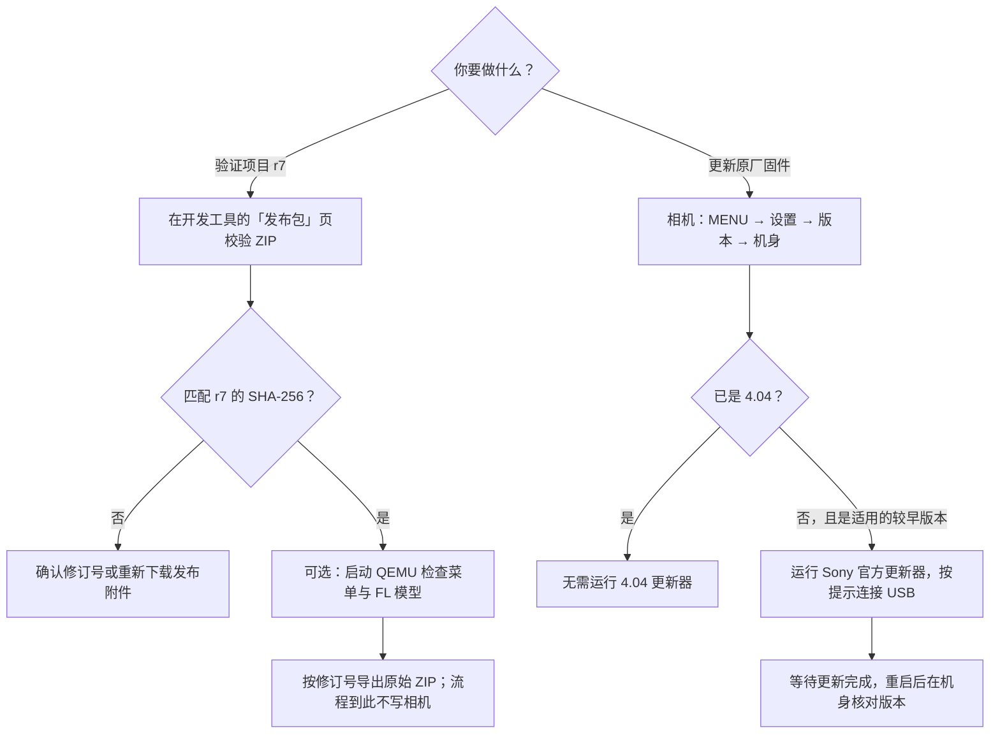

# A7M3：项目验证与官方更新

项目的 **v0.01 / r7** 是创意外观模块更新，唯一的安装组件是 `a7fl.so`。macOS 开发工具用于离线校验、仿真和导出；Sony System Software Updater 用于更新原厂系统。原厂 A7M3 4.04 没有可用的 r7 初装包。

## 用开发工具核对 r7

1. 解压本地的 `A7M3-Package-Library-macOS.zip`，打开应用，在「发布包」页点「添加文件」。选 [v0.01 Release](https://github.com/robinshie/Sony_A7M3/releases/tag/v0.01) 的 `Sony_A7M3-v0.01.zip` 附件。GitHub 自动生成的源码 ZIP 不是这个附件。
2. 确认工具显示「匹配 r7 发布 ZIP」。r5、r6、r7 曾使用同一个文件名，不能凭名称区分。没有 GUI 时，在下载目录运行 `shasum -a 256 Sony_A7M3-v0.01.zip`，r7 应为 `eff0c93cb08a3c739fe0bd93c3b42b971f82bb241b7b208918de11159c41edfb`。
3. 如果要检查界面，在装有 QEMU、并已生成本地模型 ELF 的 Mac 上点「QEMU 仿真 → FL 创意外观模型 → 启动 QEMU」。从「创意风格」旁打开「创意外观」，也可以从 Fn 进入。模型的构建和按键见 [v0.01 的 QEMU 菜单实验](https://github.com/robinshie/Sony_A7M3/blob/v0.01/docs/ui.md)。这一步运行的是独立模型，不能验证项目 ZIP 在真机上的行为。
4. 在「发布包」页点 r7 的「导出 ZIP」。工具将原包另存为 `Sony_A7M3-v0.01-r7.zip`，内容不变。已有的模块和加载器回读文件也可以在同一页比对。

**真机状态怎么判断：** 原厂 4.04 不能用项目 ZIP 初装；已验收 r7 的实验机不用重复更新。实验中验证过的是匹配 r6、已有项目加载器和菜单资源、且色彩表符合条件的机身。相机显示 4.04 或离线校验通过，都不能单独证明具备这些条件。UTM 是之前实验的 USB 转接环境，这个工具无需 UTM，不接管相机。

## 用 Sony 工具更新原厂系统

1. 在机身「MENU → 设置 → 版本」查看机型和固件版本。确认是适用的 ILCE-7M3 和较早版本；已是 4.04 则不需要更新到 4.04。
2. 下载 [Sony 官方 macOS 更新器与相机驱动](https://www.sony.com/electronics/support/software/00257843) 或 [Windows 更新器](https://www.sony.com/electronics/support/software/00257839)，按该页面的系统要求和安装向导操作。macOS 先按 Sony 说明安装驱动。
3. 充满电池、取出存储卡，将 USB 连接设为「大容量存储」，按更新器提示再连接相机。核对向导显示的当前版本和目标版本，更新期间保持供电和 USB 连接。
4. 等向导显示完成再断开 USB。开机回到机身「版本」页，确认显示 4.04。Sony 的官方包不能用于安装项目的 r7。
