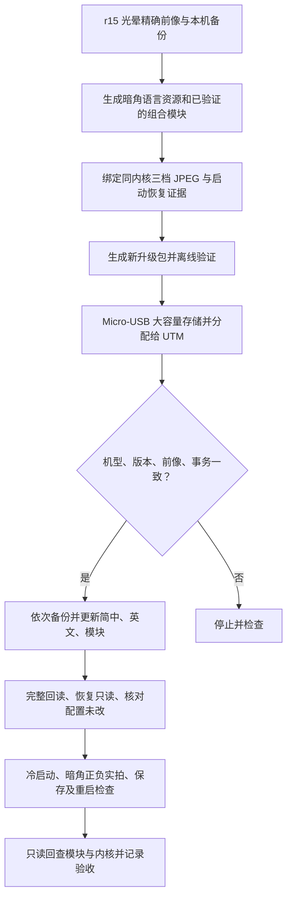

# v0.01 六风格整合版：当前入口

当前下载为同名六风格整合包，包含模块、菜单增量补丁、源码与说明。具体内容、安装条件和校验步骤见[整合版说明](six-look-release.md)。公开名称只用 v0.01；下方 r16 流程保留为历史依据，不能套用于已经刷入六风格的机身。当前开发机三文件写入、回读、冷启动菜单和新三风格拍照及保存恢复均已验收。

---

# v0.01 / r16 正负暗角：发布、验证与更新

版本号继续使用 v0.01，同名 ZIP 覆盖旧 r15 光晕附件。新增「暗角（拍后）」−9…+9：负值压暗四角、正值提亮、0 关闭，中心保持。FL、FL2、FL3 独立保存，保留颗粒、光晕、五点曲线和保存确认／取消／完成流程。清单以 `module_revision=r16`、`feature_revision=r16-vignette` 区分旧包。

已验证 **全画幅、3:2、JPEG 大尺寸 L（6000×4000）**。同一内核在固定曝光下完成 −9／0／+9 三档拍摄，每张 JPEG 与其自身编码前样本对照通过。持久版用户确认菜单、正负暗角效果和 +9 重启保留正常；回查模块、内核及保存值一致，处理成功 2 张、失败 0 张。r16 同时修复前一代确认色表保留时启动失败、创意外观入口消失的问题。

颗粒、光晕、暗角均为拍后处理，不作用于实时取景或 RAW。组合效果尚未实拍计时；每张保存完成后再拍下一张。既有光晕 −9／+9 约增加 23／25 秒，旧颗粒版强度 9 约 9 秒。其它尺寸、连拍及全部档位的实拍效果尚未覆盖。锐度、锐度范围、清晰度仍仅保存参数；五点曲线视觉效果尚待独立比较。

## 下载与校验

1. 下载 [v0.01 Release](https://github.com/robinshie/Sony_A7M3/releases/tag/v0.01) 的 **Sony_A7M3-v0.01.zip**。
2. 执行 `shasum -a 256 Sony_A7M3-v0.01.zip`，与 Release 正文核对。
3. 解压后进入 Sony_A7M3-v0.01，执行 `shasum -a 256 -c SHA256SUMS`，全部应为 OK。
4. 清单应为 `module_revision=r16`、`feature_revision=r16-vignette`。模块为 120,468 字节，SHA-256 `9fcaf13e5bcc5914d5721d797f16c3b059dc6f9b0cb99c94eda7632176306fe8`。

ZIP 包含已验收回读的 a7fl.so（内嵌拍后颗粒／光晕／暗角内核）、中文说明、版本清单、验证与流程文档及校验文件；源码由同一 v0.01 标签提供。附件不含原厂语言文件、照片、设置备份或本机绑定包。旧 Package Library GUI 仅认识 r5/r6/r7，不能验证 r16。

## 实验机更新路线

升级要求 **r15 光晕升级版**精确前像：模块 SHA-256 `a44876fb9136b4fe31c9d82ad143bf87d9b10c3d05fc8b0ba77f0348a6c3324d` 和对应语言资源、既有加载器。需由本地原厂资源生成「暗角（拍后）」的中英文新增条目，再按简中、英文、模块顺序安装。**仅覆盖 ZIP 中的模块不足以完成升级。** 原厂 4.04、r14、仅颗粒 r15 及更早项目版本不能直接使用此更新；Sony 官方更新器不能加载此 ZIP。每台设备须取得自己的原始数据和匹配基线，公开附件不是通用初装器。

所需环境：Python 3、PyUSB、Sony-PMCA 源码及依赖、libusb；Mac 使用 UTM 的 A7 III USB Lab 和 Micro-USB 数据线。构建另需 ARM GNU 工具链、QEMU、Clang，以及本地合法取得的 Sony 4.04 原厂资源。环境安装及 USB 分配见 [真机操作手册](updater.md)，资源生成、内核和菜单构建选项见 [暗角记录](vignette.md)。

部署脚本绑定本开发环境的 r15 光晕回读目录和测试证据，并非下载 ZIP 后即可运行的通用工具。在已配置的开发环境中准备本机旧前像、新暗角资源、内核自检、桥接和三档 JPEG 证据后：

```sh
# 完整构建选项见 vignette.md；候选必须已完成验证。
python3 deploy_fl_vignette.py --build-dir .lab/native-module-vignette-capture
# 将路径替换为上一步实际生成的新包；每个包只能执行一次。
python3 deploy_fl_vignette.py --package /absolute/path/update-r16-vignette-PACKAGE \
  --host-identity-check --write-device
```

若 UTM 不在默认安装位置，设置 A7M3_UTMCTL 指向 utmctl；Python 使用完整依赖环境。机型、版本、前像或事务不匹配时停止核查，不删除校验。本机已经完成 r16，不能重复执行此次事务；下一候选以当前 r16 模块及语言资源重新绑定。schema 5 兼容读取旧配置，新增暗角默认 0，确认保存后写为新格式；旧版不能读取 schema 5，回退需匹配升级前设置备份。



## 使用与真机验收

进入 MENU → 拍摄设置 1 → 第 14 页 → 创意外观，选 FL3。第三页依次为亮部、白位、**颗粒（拍后）、光晕（拍后）、暗角（拍后）**、保存。单独验证暗角时，可先将颗粒和光晕设 0，暗角分别设 −9／0／+9，保存→确认；以 M 档固定曝光、白平衡、构图拍摄，四角保留可见细节。每张保存完成再拍下一张，回放比较四角，重启后检查最后保存值。三个 FL 各自保存三项参数；本轮持久版实拍验收使用 FL3。

本机已确认 +9 重启保留，用户试用后主动保存为 −9；只读核对 schema 5、generation 55、FL3 颗粒 0、光晕 0、暗角 −9，与运行值一致。上一槽 generation 54 保留 +9。内核 diagnostic=0，处理成功 2 张、失败 0 张。完整测试、启动恢复事件及验收记录见 [暗角证据](vignette.md)。

## 重新生成公开附件

提交源码后，用已验收回读及私有验收记录打包；工具检查固定模块及内核身份、证据散列、实机验收和干净的 Git 工作区，只选取模块与公开文档：

```sh
python3 tools/package_release.py \
  --module /absolute/path/new-module-readback.so \
  --acceptance /absolute/path/acceptance-final.json \
  --out .lab/release-v001-vignette/Sony_A7M3-v0.01.zip
```

不要上传包含机主设置、备份或事务的本机升级目录。公开 ZIP 从已验收模块生成，上传后下载核对散列，并确认清单的源码提交、main 和 v0.01 标签一致。公开版仍保留实验预发布标记。

## 独立 QEMU 界面模型

已有 ELF 可用 `python3 ui/run-ui.py --guest ui/build/fl-demo/a7m3-ui.elf` 打开；构建依赖见 [QEMU 菜单实验](ui.md)。独立 UI 模型不等同于 r16 驻留模块，也不验证 ISP 或真实像素处理。原生菜单、保存与启动恢复测试由 research/native_module.py 执行，暗角直出另以实拍验证。

## 用 Sony 工具更新原厂系统

1. **确认机身和版本。** 查看机身型号标签，然后在「MENU → 设置 → 版本 → 机身」看当前版本。适用的 A7M3 原厂 4.03 或更早版本可按下列步骤更新；已是 4.04 就不需要重复更新。不要把别的机型的更新包拿来试。
2. **下载并启动工具，先别接相机。** 在 Sony 对应页面确认操作系统受支持。Mac 先打开相机驱动 DMG，运行 `SonyCameraDriver.pkg`；按官方说明处理系统扩展或重启提示。再打开 `Update_ILCE7M3V404.dmg`，运行 `SystemSoftwareUpdater`。Windows 则直接运行 `Update_ILCE7M3V404.exe`。遇到驱动许可提示，以 [Sony Mac 安装说明](https://www.sony.com/electronics/support/software/00257843)为准。
3. **准备相机。** 装入充满的 NP-FZ100，取出存储卡，拆下竖拍手柄（如有）。在相机「MENU → 设置 → USB 连接」选「大容量存储」。电脑保持供电，避免在更新期间进入睡眠。
4. **按提示接 USB。** 相机开机，使用数据线直接连电脑。看到机身的 USB 模式提示后，在更新器点「下一步」，检查当前版本与更新后的版本；只在机身和目标版本都核对无误时继续。如果还没开始写入而工具没有识别设备，先核对 USB 模式、数据线和电脑端 USB 口，再按 Sony 对应页面排查。
5. **等待完成。** 开始更新后，相机会自动重启并显示进度。不要拔 USB、取电池或关机。等相机再次启动、LCD 恢复、更新器可以点「完成」，点完再拔 USB。若更新未完成或报错，按 [Sony Mac](https://www.sony.com/electronics/support/software/00257843)或 [Sony Windows](https://www.sony.com/electronics/support/software/00257839)页面的故障处理说明操作。
6. **回查版本。** 在机身「MENU → 设置 → 版本 → 机身」确认是 4.04。这个结果表示原厂系统更新完成，不表示安装了项目 r16。
