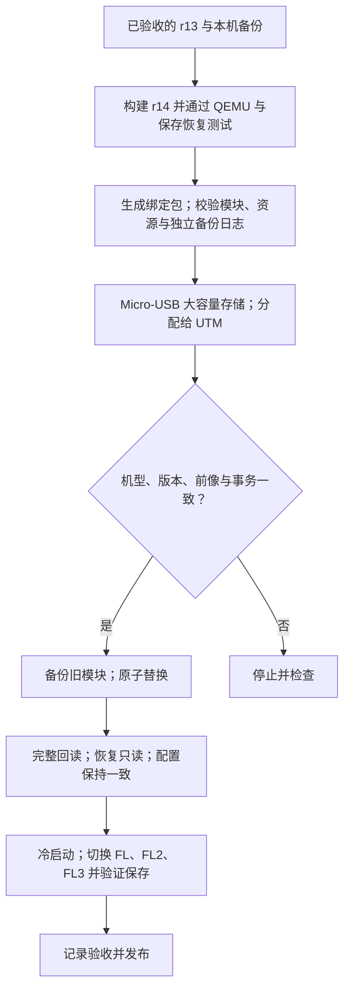

# v0.01 / r14 发布、验证与更新

v0.01 现在对应内部 r14，同名 ZIP 覆盖旧 r9 版本。新增 FL2、FL3 和三个风格的独立五点曲线。真机验收确认：三个风格曲线独立，保存及重启后保留。早期 r9 的取景刷新验收保留在历史文档；本轮没有把它作为五点曲线的视觉效果验收。颗粒、光晕未接入发布模块；锐度、锐度范围、清晰度仍仅保存参数。

## 下载与校验

1. 下载 [v0.01 Release](https://github.com/robinshie/Sony_A7M3/releases/tag/v0.01) 的 **Sony_A7M3-v0.01.zip**。
2. 对 ZIP 执行 `shasum -a 256 Sony_A7M3-v0.01.zip`，与 Release 正文核对。
3. 解压后进入 Sony_A7M3-v0.01，执行 `shasum -a 256 -c SHA256SUMS`，全部应为 OK。
4. 查看 release-manifest.json：module_revision 应为 r14，模块 SHA-256 为 `28a7c2178d701324363d8824a9bc1648f5df44c2d75f260565e51e2c96ccdd38`。

ZIP 内有 a7fl.so、中文说明、清单及校验文件；源码由同一个 v0.01 标签提供。源码中的帧接口、颗粒和光晕属于未交付研究，不代表发布模块已经实现。旧 Package Library GUI 仅认识 r5/r6/r7，不能验证 r14。

## 实验机更新路线

r14 只更新模块，沿用 r13 菜单语言资源、加载器和 schema 4 配置。原厂 4.04 和早期项目版本不能直接安装 r14；Sony 官方更新器也不能加载此 ZIP。每台设备必须使用自己的原始数据和精确基线；公开附件不包含本机绑定更新包。

所需环境：Python 3、PyUSB、Sony-PMCA 源码及其依赖、libusb；Mac 使用 UTM 的 A7 III USB Lab 和 Micro-USB 数据线。开发构建另需 ARM GNU 工具链、QEMU 与本地合法取得的 Sony 4.04 原厂资源。安装与 USB 分配详见 [真机操作手册](updater.md)，构建详见 [五点曲线](fl3-film-controls.md)。

在已配置的开发目录、已有本机 r13 完整回读基线时：

```sh
python3 deploy_fl_all_curves.py --build-dir .lab/native-module-fl3-curves
# 上一步生成并验证绑定包，尚未写入。把路径换为实际输出：
python3 deploy_fl_all_curves.py --package /absolute/path/update-r14-all-curves-PACKAGE \
  --host-identity-check --write-device
```

如 UTM 不在默认安装位置，设置 A7M3_UTMCTL 指向其 utmctl；Python 应使用安装完整依赖的环境。不能删掉校验去适配不同相机，也不能重复本机已完成的事务。



## r14 真机验收

等存取灯熄灭后关机拔 USB，取电池约 10 秒再开机。进入 MENU → 拍摄设置 1 → 第 14 页 → 创意外观。选择 FL、FL2、FL3，分别调不同曲线值并确认保存。第 2 页末尾是黑位、暗部、中间调；第 3 页为亮部、白位和保存。切换与重启后各组值应独立保留。

用户已确认上述数值保留测试通过。模块写入与完整回读通过；本机不再执行本次写入命令。曲线实际取景／成片效果需另行比较。

## 独立 QEMU 界面模型

已有 ELF 可用 `python3 ui/run-ui.py --guest ui/build/fl-demo/a7m3-ui.elf` 打开；构建需要 QEMU、ARM GCC、Python、Pillow 和本地原厂资源，详见 [QEMU 菜单实验](ui.md)。独立 UI 模型不等同于 r14 驻留模块；五点曲线的实际原生节点与恢复测试由 research/native_module.py 执行。

## 用 Sony 工具更新原厂系统

1. **确认机身和版本。** 查看机身型号标签，然后在「MENU → 设置 → 版本 → 机身」看当前版本。适用的 A7M3 原厂 4.03 或更早版本可按下列步骤更新；已是 4.04 就不需要重复更新。不要把别的机型的更新包拿来试。
2. **下载并启动工具，先别接相机。** 在 Sony 对应页面确认操作系统受支持。Mac 先打开相机驱动 DMG，运行 `SonyCameraDriver.pkg`；按官方说明处理系统扩展或重启提示。再打开 `Update_ILCE7M3V404.dmg`，运行 `SystemSoftwareUpdater`。Windows 则直接运行 `Update_ILCE7M3V404.exe`。遇到驱动许可提示，以 [Sony Mac 安装说明](https://www.sony.com/electronics/support/software/00257843)为准。
3. **准备相机。** 装入充满的 NP-FZ100，取出存储卡，拆下竖拍手柄（如有）。在相机「MENU → 设置 → USB 连接」选「大容量存储」。电脑保持供电，避免在更新期间进入睡眠。
4. **按提示接 USB。** 相机开机，使用数据线直接连电脑。看到机身的 USB 模式提示后，在更新器点「下一步」，检查当前版本与更新后的版本；只在机身和目标版本都核对无误时继续。如果还没开始写入而工具没有识别设备，先核对 USB 模式、数据线和电脑端 USB 口，再按 Sony 对应页面排查。
5. **等待完成。** 开始更新后，相机会自动重启并显示进度。不要拔 USB、取电池或关机。等相机再次启动、LCD 恢复、更新器可以点「完成」，点完再拔 USB。若更新未完成或报错，按 [Sony Mac](https://www.sony.com/electronics/support/software/00257843)或 [Sony Windows](https://www.sony.com/electronics/support/software/00257839)页面的故障处理说明操作。
6. **回查版本。** 在机身「MENU → 设置 → 版本 → 机身」确认是 4.04。这个结果表示原厂系统更新完成，不表示安装了项目 r14。
