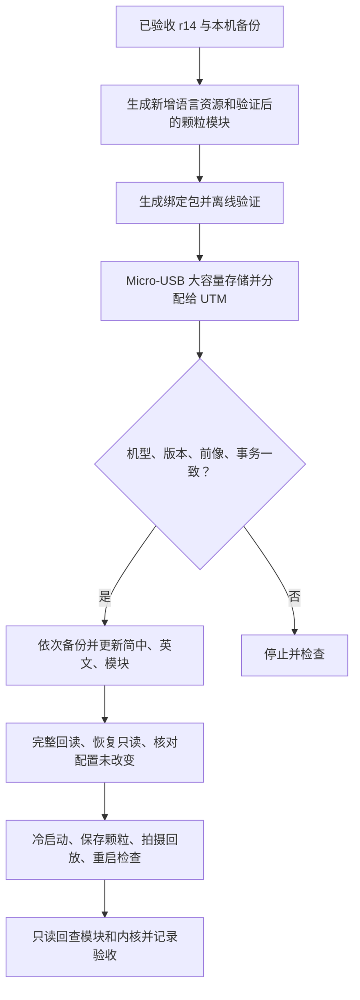

# v0.01 / r15 发布、验证与更新

版本号继续使用 v0.01，同名 ZIP 覆盖旧 r14 附件。r15 新增「颗粒（拍后）」0–9 档，三个 FL 独立保存；已有 FL、FL2、FL3 配色和独立五点曲线保留。FL3 颗粒的菜单、拍摄回放及重启保留已获用户确认，冷启动回查模块和内核正常、处理完成 1 张、失败 0 张。此前临时内核两张连续单拍均通过，最后一张 8.74 秒。

已验证**全画幅、3:2、JPEG 大尺寸 L（6000×4000）**；强度 9 每张约增加 9 秒。颗粒不作用于实时取景或 RAW，光晕未接入，锐度、锐度范围、清晰度仍仅保存参数。其他尺寸、连拍及所有强度的真机效果没有由本轮验收覆盖。五点曲线保存验收与其视觉效果验证分开记录。

## 下载与校验

1. 下载 [v0.01 Release](https://github.com/robinshie/Sony_A7M3/releases/tag/v0.01) 的 **Sony_A7M3-v0.01.zip**。
2. 执行 `shasum -a 256 Sony_A7M3-v0.01.zip`，与 Release 正文核对。
3. 解压后进入 Sony_A7M3-v0.01，执行 `shasum -a 256 -c SHA256SUMS`，全部应为 OK。
4. 清单 `release-manifest.json` 的 `module_revision` 应为 `r15`，模块 115,380 字节，SHA-256 为 `33d103c891660cf9521a7661a31c114252070bd2c49c92f930079bc10c15c49d`。

ZIP 包含已回读的 a7fl.so（内嵌拍后颗粒内核）、中文说明、验证记录、流程文档和校验文件；源码由同一个 v0.01 标签提供。附件不含原厂语言文件、设置备份、照片或本机绑定包。旧 Package Library GUI 仅认识 r5/r6/r7，不能验证 r15。

## 实验机更新路线

r15 沿用既有加载器和 schema 4 配置，但需新增中英文「颗粒（拍后）」资源，安装顺序为简中资源、英文资源、模块。**只把 ZIP 中模块覆盖到 r14 不足以完成升级。** 原厂 4.04 和早期项目版本不能直接安装本更新；Sony 官方更新器不能加载此 ZIP。每台设备须取得自己的原始数据和精确基线，公开附件不是通用初装器。

所需环境：Python 3、PyUSB、Sony-PMCA 源码及依赖、libusb；Mac 使用 UTM 的 A7 III USB Lab 和 Micro-USB 数据线。构建另需 ARM GNU 工具链、QEMU、Clang，以及本地合法取得的 Sony 4.04 原厂资源。环境与 USB 分配见 [真机操作手册](updater.md)，完整研究和构建选项见 [颗粒研究记录](grain-research.md)。

当前部署脚本绑定本开发环境的 r14 回读目录和测试证据，并非下载 ZIP 后即可运行的通用工具。已配置的开发环境准备好本机 r14 前像、r15 资源、颗粒内核及桥接实拍证据后：

```sh
# 完整构建选项见 grain-research.md；此处候选须已完成验证。
python3 deploy_fl_grain.py --build-dir .lab/native-module-grain-capture
# 上一步仅准备绑定包，将路径替换为实际输出。
python3 deploy_fl_grain.py --package /absolute/path/update-r15-grain-PACKAGE \
  --host-identity-check --write-device
```

若 UTM 不在默认安装位置，设置 A7M3_UTMCTL 指向 utmctl；Python 使用完整依赖环境。前像不匹配时应停止并核查，不删除校验。本机已经完成 r15，不能重复执行此次事务；下一候选以 r15 为前像重新制作更新包。



## 使用与真机验收

进入 MENU → 拍摄设置 1 → 第 14 页 → 创意外观，选择 FL3。第三页依次为亮部、白位、**颗粒（拍后）**、保存。将颗粒设为 1–9，保存→确认；0 为关闭。使用全画幅 3:2 JPEG L，等一张保存完成再拍下一张；放大回放查看颗粒。重启后检查数值保留。FL、FL2、FL3 各自保存颗粒参数，独立组的离线测试通过，本轮真机颗粒验收使用 FL3。

本机 r15 完整写入回读通过，用户已确认菜单、拍摄回放及重启后颗粒 9 保留。随后用户主动调回 0，最新配置和内核均为关闭，与反馈一致。该记录不代表光晕、实时颗粒或其他格式已经实现。证据见 [颗粒研究](grain-research.md)。

## 独立 QEMU 界面模型

已有 ELF 可用 `python3 ui/run-ui.py --guest ui/build/fl-demo/a7m3-ui.elf` 打开；构建依赖见 [QEMU 菜单实验](ui.md)。独立 UI 模型不等同于 r15 驻留模块，也不验证 ISP 或相机内核的实际像素处理；原生菜单及保存恢复测试由 research/native_module.py 执行，真实颗粒效果另以实拍验证。

## 用 Sony 工具更新原厂系统

1. **确认机身和版本。** 查看机身型号标签，然后在「MENU → 设置 → 版本 → 机身」看当前版本。适用的 A7M3 原厂 4.03 或更早版本可按下列步骤更新；已是 4.04 就不需要重复更新。不要把别的机型的更新包拿来试。
2. **下载并启动工具，先别接相机。** 在 Sony 对应页面确认操作系统受支持。Mac 先打开相机驱动 DMG，运行 `SonyCameraDriver.pkg`；按官方说明处理系统扩展或重启提示。再打开 `Update_ILCE7M3V404.dmg`，运行 `SystemSoftwareUpdater`。Windows 则直接运行 `Update_ILCE7M3V404.exe`。遇到驱动许可提示，以 [Sony Mac 安装说明](https://www.sony.com/electronics/support/software/00257843)为准。
3. **准备相机。** 装入充满的 NP-FZ100，取出存储卡，拆下竖拍手柄（如有）。在相机「MENU → 设置 → USB 连接」选「大容量存储」。电脑保持供电，避免在更新期间进入睡眠。
4. **按提示接 USB。** 相机开机，使用数据线直接连电脑。看到机身的 USB 模式提示后，在更新器点「下一步」，检查当前版本与更新后的版本；只在机身和目标版本都核对无误时继续。如果还没开始写入而工具没有识别设备，先核对 USB 模式、数据线和电脑端 USB 口，再按 Sony 对应页面排查。
5. **等待完成。** 开始更新后，相机会自动重启并显示进度。不要拔 USB、取电池或关机。等相机再次启动、LCD 恢复、更新器可以点「完成」，点完再拔 USB。若更新未完成或报错，按 [Sony Mac](https://www.sony.com/electronics/support/software/00257843)或 [Sony Windows](https://www.sony.com/electronics/support/software/00257839)页面的故障处理说明操作。
6. **回查版本。** 在机身「MENU → 设置 → 版本 → 机身」确认是 4.04。这个结果表示原厂系统更新完成，不表示安装了项目 r15。
