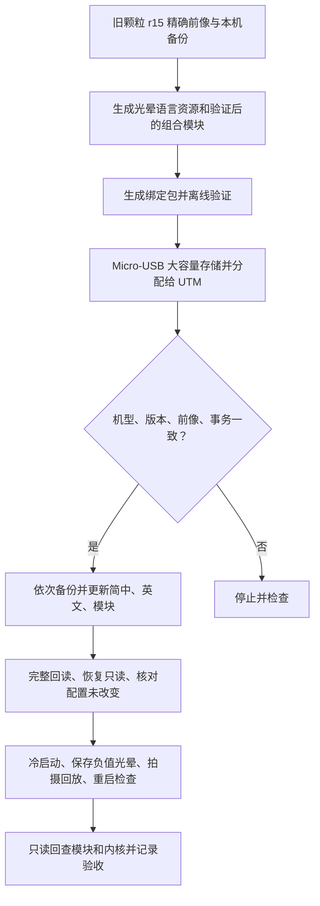

# v0.01 / r15 光晕升级版：发布、验证与更新

版本号继续使用 v0.01，同名 ZIP 覆盖旧颗粒 r15 附件。本次新增「光晕（拍后）」−9…+9：负值压暗高光周围，正值为暖色亮晕，0关闭；颗粒0–9、三个FL独立参数、五点曲线和保存确认流程保留。清单以 `feature_revision=r15-halation` 区分旧的同名 r15 包。

已验证**全画幅、3:2、JPEG 大尺寸 L（6000×4000）**。临时模块固定曝光−9／0／+9实拍已验证进入JPEG，负档压暗、正档暖色提亮、0不改源像素；−9／+9每张约增加23／25秒。持久版FL3菜单、拍摄回放和−9重启保留获用户确认；回读模块、内核和保存值一致，处理1张、失败0张。旧颗粒版强度9约增加9秒，两项叠加尚未实拍计时。颗粒与光晕不作用于实时取景或RAW；其它尺寸、连拍及所有档位的真机效果尚未覆盖。锐度、锐度范围、清晰度仍仅保存参数，五点曲线视觉效果仍待独立验收。

## 下载与校验

1. 下载 [v0.01 Release](https://github.com/robinshie/Sony_A7M3/releases/tag/v0.01) 的 **Sony_A7M3-v0.01.zip**。
2. 执行 `shasum -a 256 Sony_A7M3-v0.01.zip`，与 Release 正文核对。
3. 解压后进入 Sony_A7M3-v0.01，执行 `shasum -a 256 -c SHA256SUMS`，全部应为 OK。
4. 清单 `release-manifest.json` 应为 `module_revision=r15`、`feature_revision=r15-halation`，模块115,120字节，SHA-256为 `a44876fb9136b4fe31c9d82ad143bf87d9b10c3d05fc8b0ba77f0348a6c3324d`。

ZIP 包含已回读的 a7fl.so（内嵌拍后颗粒／光晕内核）、中文说明、验证记录、流程文档和校验文件；源码由同一个 v0.01 标签提供。附件不含原厂语言文件、设置备份、照片或本机绑定包。旧 Package Library GUI 仅认识 r5/r6/r7，不能验证 r15。

## 实验机更新路线

本升级沿用既有加载器和schema 4配置，要求旧颗粒r15模块 SHA-256 `33d103c891660cf9521a7661a31c114252070bd2c49c92f930079bc10c15c49d` 及对应语言资源。需追加中英文「光晕（拍后）」资源，安装顺序为简中资源、英文资源、模块。**仅覆盖ZIP中的模块不足以完成升级。** 原厂4.04、r14及早期项目版本不能直接安装本更新；Sony官方更新器不能加载此ZIP。每台设备须取得自己的原始数据和精确基线，公开附件不是通用初装器。

所需环境：Python 3、PyUSB、Sony-PMCA源码及依赖、libusb；Mac使用UTM的A7 III USB Lab和Micro-USB数据线。构建另需ARM GNU工具链、QEMU、Clang，以及本地合法取得的Sony 4.04原厂资源。环境与USB分配见 [真机操作手册](updater.md)，完整研究、资源生成、内核和菜单构建选项见 [光晕记录](fl3-film-controls.md)。

部署脚本绑定本开发环境的旧颗粒r15回读目录和测试证据，并非下载ZIP后即可运行的通用工具。已配置的开发环境准备好本机旧r15前像、新光晕资源、生产内核及桥接和实拍证据后：

```sh
# 完整构建选项见 fl3-film-controls.md；此处候选须已完成验证。
python3 deploy_fl_halation.py --build-dir .lab/native-module-film-capture
# 上一步仅准备绑定包，将路径替换为实际输出。
python3 deploy_fl_halation.py --package /absolute/path/update-r15-halation-PACKAGE \
  --host-identity-check --write-device
```

若UTM不在默认安装位置，设置A7M3_UTMCTL指向utmctl；Python使用完整依赖环境。前像不匹配时应停止并核查，不删除校验。本机已经完成光晕升级，不能重复执行此次事务；下一候选以当前光晕模块及语言文件为前像重新制作更新包。负值沿用schema 4已有光晕槽位，旧颗粒r15不接受负值光晕配置；回退需同时核对、使用本机升级前留存的设置备份。



## 使用与真机验收

进入MENU → 拍摄设置1 → 第14页 → 创意外观，选择FL3。第三页依次为亮部、白位、**颗粒（拍后）、光晕（拍后）**、保存。首次对照可先将颗粒设0，光晕分别设−9／0／+9并保存→确认；使用M档固定曝光、白平衡、构图，画面包含亮灯或高光反射边缘及较暗背景。每张保存完成再拍下一张，回放比较高光周围；这不是按画面四角生成的暗角。重启后检查数值保留。三个FL各自保存两项参数，独立组的离线测试通过，本轮持久光晕实拍验收使用FL3、−9。

本机光晕升级完整写入回读通过，用户确认菜单可调、拍摄回放正常、重启−9保留。只读回查保存generation 53、FL3、颗粒0、光晕−9，与驻留模块和内核一致，完成1张、失败0张。临时三档JPEG对照、驻留版自检、菜单保存与冷启动验收分别记录，见 [光晕证据](fl3-film-controls.md)。

## 重新生成公开附件

提交源码后，用已验收回读及私有验收记录打包；工具检查模块散列、证据散列和干净的Git工作区，只选取模块与公开文档：

```sh
python3 tools/package_release.py \
  --module /absolute/path/new-module-readback.so \
  --acceptance /absolute/path/acceptance-final.json \
  --out .lab/release-v001-halation/Sony_A7M3-v0.01.zip
```

私有 `Sony_A7M3-r15-halation-local-upgrade.zip` 含机主设置、备份和事务，不作为公开Release附件。公开ZIP从验收模块重新生成；上传后须下载校验，并确认ZIP清单中的源码提交、main和v0.01标签一致。

## 独立 QEMU 界面模型

已有 ELF 可用 `python3 ui/run-ui.py --guest ui/build/fl-demo/a7m3-ui.elf` 打开；构建依赖见 [QEMU 菜单实验](ui.md)。独立 UI 模型不等同于 r15 驻留模块，也不验证 ISP 或相机内核的实际像素处理；原生菜单及保存恢复测试由 research/native_module.py 执行，真实颗粒效果另以实拍验证。

## 用 Sony 工具更新原厂系统

1. **确认机身和版本。** 查看机身型号标签，然后在「MENU → 设置 → 版本 → 机身」看当前版本。适用的 A7M3 原厂 4.03 或更早版本可按下列步骤更新；已是 4.04 就不需要重复更新。不要把别的机型的更新包拿来试。
2. **下载并启动工具，先别接相机。** 在 Sony 对应页面确认操作系统受支持。Mac 先打开相机驱动 DMG，运行 `SonyCameraDriver.pkg`；按官方说明处理系统扩展或重启提示。再打开 `Update_ILCE7M3V404.dmg`，运行 `SystemSoftwareUpdater`。Windows 则直接运行 `Update_ILCE7M3V404.exe`。遇到驱动许可提示，以 [Sony Mac 安装说明](https://www.sony.com/electronics/support/software/00257843)为准。
3. **准备相机。** 装入充满的 NP-FZ100，取出存储卡，拆下竖拍手柄（如有）。在相机「MENU → 设置 → USB 连接」选「大容量存储」。电脑保持供电，避免在更新期间进入睡眠。
4. **按提示接 USB。** 相机开机，使用数据线直接连电脑。看到机身的 USB 模式提示后，在更新器点「下一步」，检查当前版本与更新后的版本；只在机身和目标版本都核对无误时继续。如果还没开始写入而工具没有识别设备，先核对 USB 模式、数据线和电脑端 USB 口，再按 Sony 对应页面排查。
5. **等待完成。** 开始更新后，相机会自动重启并显示进度。不要拔 USB、取电池或关机。等相机再次启动、LCD 恢复、更新器可以点「完成」，点完再拔 USB。若更新未完成或报错，按 [Sony Mac](https://www.sony.com/electronics/support/software/00257843)或 [Sony Windows](https://www.sony.com/electronics/support/software/00257839)页面的故障处理说明操作。
6. **回查版本。** 在机身「MENU → 设置 → 版本 → 机身」确认是 4.04。这个结果表示原厂系统更新完成，不表示安装了项目 r15。
