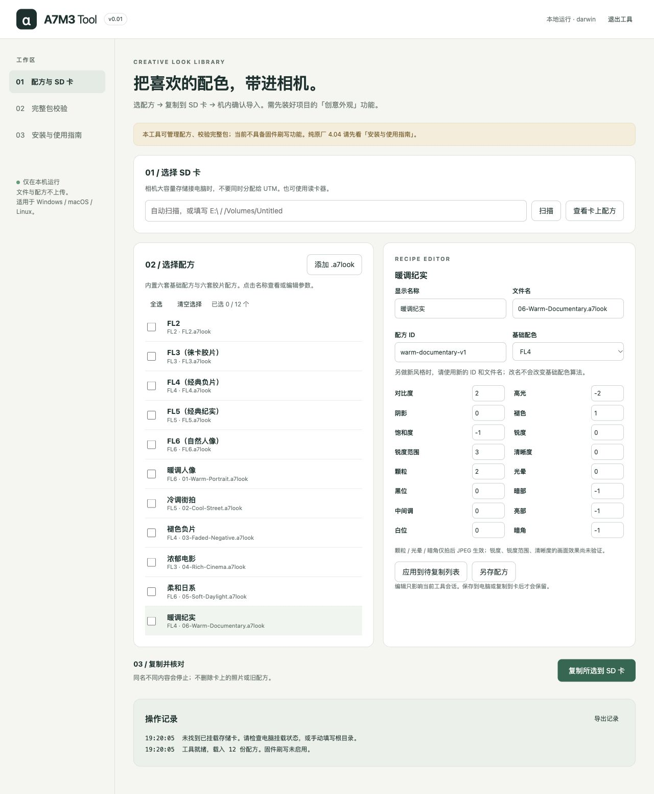

# Sony A7M3 Tool · v0.01

Windows、macOS、Linux 共用的中文 GUI，放在仓库 `tool/`。启动后自动打开本机浏览器窗口，不需要登录、不上传文件，源码版只需 Python 3.10+，不需要 Tk、Node、UTM 或额外 Python 库。

**当前提供配方管理与完整包校验，没有接入相机固件刷写后端。** 纯原厂 4.04 不能靠此工具获得创意外观菜单；已装项目功能的相机可以使用 SD 配方流程。界面中「首次安装」保持禁用，这不是刷机完成按钮。



## 下载包怎么选

| 文件 | 使用方式 |
| --- | --- |
| `Sony_A7M3-Tool.zip` | 三个平台共用的源码运行包，先安装 Python 3.10+ |
| `Sony_A7M3-Tool-Windows-AMD64.zip` | Windows x64 独立运行包；解压全部文件，打开 `A7M3-Tool.exe` |
| `Sony_A7M3-Tool-macOS-arm64.zip` | Apple Silicon Mac 独立运行包；解压全部文件，打开 `Start-macOS.command` |
| `Sony_A7M3-Tool-macOS-x86_64.zip` | Intel Mac 独立运行包；同上 |
| `Sony_A7M3-Tool-Linux-x86_64.zip` | Linux 独立运行包；运行 `./A7M3-Tool` |

原生包只在对应系统／架构完成构建后才会存在。`tool-gui.yml` 负责 Windows x64、Mac arm64 与 Linux x64 构建，Intel Mac 可在对应机器上构建。CI 配置存在不代表各平台已经验收；以 Actions 结果和发布附件为准。不把源码 ZIP 改名成 exe 或 app。

独立运行包包含 Python；不要只复制其中的可执行文件，`_internal` 等目录也要保留。包未做 Windows 商业签名或 Apple 公证；请核对项目来源和校验值，不要为运行它关闭系统安全保护。浏览器关闭后后台服务仍运行，退出请点右上角「退出工具」或在启动终端按 Ctrl+C。

## 小白启动步骤

### Windows 源码运行包

1. 从 [Python 官网](https://www.python.org/downloads/) 安装 Python 3.10 或更新版本，保留 Python Launcher。
2. 将整个 `Sony_A7M3-Tool.zip` 解压到一个普通文件夹，不能直接在 ZIP 内运行。
3. 双击 `Start-Windows.cmd`。默认浏览器会打开中文工具页面。
4. 如果提示找不到 Python，可在该目录的终端运行 `py -3 app.py`。不需要管理员运行，不需要安装或替换 USB 驱动。

### macOS 源码运行包

1. 安装 Python 3.10+；macOS 自带的旧 Python 不一定满足要求。
2. 解压全部文件，双击 `Start-macOS.command`。
3. 如果脚本没有执行权限，在终端进入解压目录，运行 `sh Start-macOS.command`；也可以直接运行 `python3 app.py`。启动器会优先寻找 Homebrew 的 Python，再检查默认 Python。

### Linux 源码运行包

安装 Python 3.10+ 与桌面浏览器，解压后运行 `sh start-linux.sh`。无图形环境时可运行 `python3 app.py --no-browser`，用同一台电脑的浏览器打开终端打印的地址。工具只监听 `127.0.0.1`，不提供远程局域网服务。

## 已安装创意外观：复制配方到相机

1. 在相机选择「USB 连接 → 大容量存储」，用 Micro-USB 数据线接电脑；或把 SD 卡放入读卡器。Mac 这一步不要把相机分配给 UTM。
2. 确认文件管理器能打开存储卡。在工具「配方与 SD 卡」点「扫描」，选择正确的卡根目录。扫描不到时手填，例如 Windows `E:\`、Mac `/Volumes/Untitled`、Linux `/media/用户名/卡名`。根目录应包含 `DCIM`、`AVF_INFO` 或 `PRIVATE`，不要选 `DCIM` 里面，也不要选 PMHOME。
3. 勾选配方；也可以点「添加 .a7look」选择自己的文件。工具附六份基础配方和六份胶片配方。
4. 点「复制所选到 SD 卡」，核对目标路径及文件列表，确认。工具先校验全部输入，再创建文件并执行完整回读。已有相同配方跳过；同名不同内容、不同文件但重复 ID 会停止，不自动覆盖。
5. 等操作记录显示复制／回读完成，在系统文件管理器里**安全推出**，等存取灯熄灭后拔 USB。工具不会自动推出磁盘。
6. 相机 MENU → 拍摄设置 1 → 第 14 页 → 与创意外观同级的「从 SD 卡导入」。左右选文件，确认文件名、确认导入，看到「完成」。
7. 进入「创意外观」选择新增名称，调整后执行保存 → 确认。拍 JPEG 并回放，再重启检查保存。

复制到 SD 卡和导入机身是两个步骤；修改卡上文件不会自动更新已经导入的机内风格。文件名任意，但扩展名须为 `.a7look`，内容须为 `A7FL-LOOK/1`，不能只改后缀。卡上列表最多 32 个配方、机内最多 16 个自定义外观（满额实机尚未逐项验收）。此工具不删除卡上文件，也不修改相机现有参数。

## 编辑／分享新配方

点击配方名称，右侧可编辑名称、稳定 ID、基础 FL 和全部 16 个参数。另做新风格时换一个 ID 与文件名，例如 `autumn-warm-02` 和 `Autumn-warm-02.a7look`；ID 限小写英文字母、数字、短横线、下划线，最多 48 字符。名称最多 63 个 UTF-8 字节，中文通常每字 3 字节。

- 「应用到待复制列表」仅保留本次会话的编辑，之后勾选并复制到卡。
- 「另存配方」由浏览器下载到电脑，可分享给其他已安装项目功能的用户。
- 切换配方时遇到未应用编辑会提示；复制时若仍有未应用编辑会停止，避免复制旧值。

这里是参数编辑器，不提供照片效果预览。配方引用 FL～FL6 已有基础配色，不能导入新算法或任意 LUT。颗粒、正负光晕、正负暗角的已验证范围为全画幅 3:2 JPEG L/M/S，属于拍后处理，强效果可能增加保存时间。锐度、锐度范围、清晰度只确认调节和保存；不能据此承诺三项改变照片。内置胶片配方是近似风格，不承诺复刻品牌算法。

## 核对 v0.01 完整功能包

在「完整包校验」选择从 [项目 Release](https://github.com/robinshie/Sony_A7M3/releases/tag/v0.01) 下载的 `Sony_A7M3-v0.01.zip`，可填写发布页提供的 SHA-256，再点校验。

工具检查整个 ZIP 外部散列（填写时）、全部 `SHA256SUMS` 条目、清单模块的长度与散列，显示源码提交与依赖基线。不解压、不运行包内代码。包内自带的散列仅能证明内部一致性，不能代替来源验证。校验通过不代表与某台机身兼容，更不表示已经安装。

`Sony_A7M3-Tool.zip` 和旧 `Sony_A7M3-SD-Recipe-Tool.zip` 是电脑工具，不是固件完整包，因此不会通过此处的固件包格式检查。

## 原厂 4.04 首次安装还缺什么

现有历史部署脚本绑定开发机精确前像、私有备份、加载器、菜单与验收证据，不能拿来给原厂机直接重放。GUI 不调用这些脚本，不改变它们的校验条件。

尚需实现并验收的完整安装后端：

1. Windows / Mac 各自的 USB 访问、机型版本与原厂基线识别。
2. 每台机身独立备份与恢复记录，核对空间和待写文件前像。
3. 从原厂 4.04 一次安装匹配的加载器、菜单资源和当前模块；保留用户配置。
4. 写入状态日志、全量回读及失败处理；不能凭进度条判断成功。
5. 从纯原厂机冷启动后验证入口、SD 导入、保存、拍摄和再次断电保留。

在这条链路验证前，此 GUI 仅完成电脑端工具；不能称为已交付的多平台首次刷机器。Sony 官方更新器安装的是原厂 4.04，也不会安装这些自定义功能。

## 开发、测试和打包

从仓库根目录运行：

```sh
python3 -m unittest discover -s tool -p 'test_*.py' -v
python3 tool/app.py
python3 tool/build.py
```

第三条生成 `dist/Sony_A7M3-Tool.zip` 和同名 `.sha256`，仅含公开代码、页面、说明和 12 份配方，不含照片、机身备份、Sony 原厂固件或虚拟机。运行包与仓库源码使用同一个配方解析器。

在目标系统构建独立运行包：

```sh
python3 -m venv .venv-tool
# 激活环境：Windows .venv-tool\Scripts\activate；Mac/Linux source .venv-tool/bin/activate
python -m pip install 'pyinstaller>=6.10,<7'
python tool/build.py --native
```

输出为 `dist/Sony_A7M3-Tool-系统-架构.zip`。原生包需要在对应操作系统上构建，参见 [PyInstaller 构建说明](https://pyinstaller.org/en/stable/operating-mode.html)。GitHub Actions 的 `Build A7M3 GUI tool` 提供三系统构建、单元测试与产物上传；不会自动覆盖固件 Release。

构建后执行 `python tool/smoke_bundle.py dist`，从新解压的原生包启动，检查随包配方、隔离目录复制与回读、正常退出。CI 同样执行这一步。Mac 本地已通过 19 项测试、源码 GUI 编辑→复制→回读、真实发布 ZIP 605 文件校验以及原生包启动。测试只写隔离目录，没有接触用户 SD 卡或刷写相机。

HTTP 服务绑定回环地址，使用启动时随机令牌、Host 与 Origin 校验；只有工具窗口可以调用操作接口。配方文件名、参数、ZIP 路径与大小都做校验，不执行导入内容。操作记录只留在当前页面，点击「导出记录」才下载；分享前可自行检查其中的路径和配方名称。

测试覆盖：配方校验、重复及冲突、部分复制失败、卡上数量上限、完整回读、恶意 ZIP 路径／重复条目／软链接、哈希篡改、HTTP 授权与不存在刷写接口。当前设备上的 Windows/Linux USB 挂载实测、纯原厂首次安装不在这些离线测试结论内。
